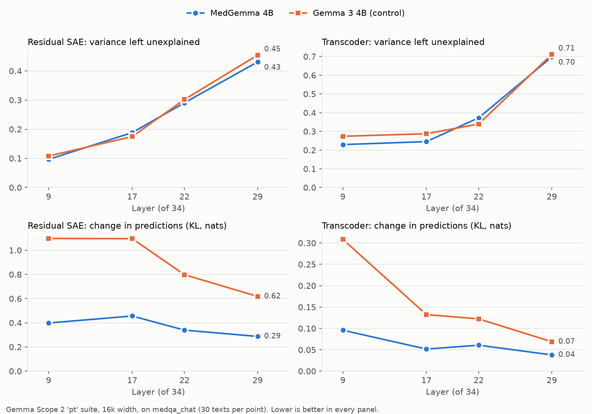

# Phase 0 report: setup and feasibility

**Date:** 2026-11-14 · **Status:** complete

## Summary

The plan is feasible on a laptop for everything that looks inside the model.

- **MedGemma 4B runs locally.** It loads on the Mac's GPU, uses at most 11.6 GiB of the
  24 GiB of memory, and answers 52% of MedQA exam questions correctly (chance is 25%).
- **Google's Gemma Scope 2 tools fit MedGemma about as well as they fit the model they
  were built for.** Against a rule we set before seeing the full results, they pass in 47
  of 48 medical-text comparisons. So Phase 2 can use them without first adapting them.
- **All three datasets load:** MedQA, MedMCQA and the MPIB prompt-injection benchmark.
- **MedGemma 27B cannot run on this machine.** It needs about 54 GB just for its weights,
  so it is limited to black-box tests on other hardware, as planned.

Three things need attention in later phases: generation is slow (12 tokens per second),
the smallest SAEs reconstruct later layers poorly, and one surprising result needs a
control experiment (see "Problems and caveats").

## What was built

| Piece | What it does |
|---|---|
| `configs/phase0.yaml` | All settings, with a `debug:` block for small fast runs |
| `src/medlens/runs.py` | Each run gets its own folder with its config, git commit, package versions and log |
| `src/medlens/data/` | MedQA, MedMCQA, MPIB and WikiText loaders, all converted to one question format |
| `src/medlens/models/` | One interface for local models (with hooks that read or replace internal activity) and for Claude via the API (with a response cache and cost tracking) |
| `src/medlens/interp/` | Loads Gemma Scope 2 through SAELens and measures how well it fits |
| `src/medlens/eval/` | Prompts, answer extraction, confidence intervals |
| `scripts/phase0_*.py` | The four feasibility checks and the figure |
| `tests/` | 35 tests, including hook and SAE-metric tests on a tiny random Gemma 3 model |

## What ran

| Check | Run folder (`outputs/`, not committed) | Runtime |
|---|---|---|
| Hardware and memory report | `phase0_env_report/20261114-140337` | seconds |
| Dataset check | `phase0_data_check/20261114-140346` | ~15 s |
| Model check (full) | `phase0_model_check/20261114-142730` | ~11 min |
| SAE fit check (full) | `phase0_sae_recon/20261114-143911` | 90 min |

Debug versions of the model and SAE checks also ran successfully first.

## Results

### 1. Hardware

Apple M4, 24 GiB unified memory, no NVIDIA GPU (the Mac GPU is used through PyTorch's
"MPS" backend), about 38 GB of free disk at the time of the run.

Memory estimates, computed from Hugging Face metadata:

| | MedGemma 4B | MedGemma 27B |
|---|---|---|
| Parameters | 4.30 B (includes an unused image encoder) | 27.0 B |
| Weights at full precision (bf16) | 8.6 GB | 54.0 GB |
| Layers / hidden size | 34 / 2,560 | 62 / 5,376 |
| Activations, all layers, per 1,000 tokens | 174 MB | 667 MB |
| Activations, 4 layers, per 1,000 tokens | 20 MB | 43 MB |
| One wide transcoder (262k features) | 5.4 GB | 11.4 GB |
| Rough total: weights + one wide transcoder + 10% working memory | ~15 GB | ~71 GB |

**Measured** for 4B: 8.1 GiB after loading, 11.6 GiB peak during the model check.

**Recommended sizes:**
- **Development and final internals work:** MedGemma 4B, on this laptop.
- **27B, black-box only:** needs an 80 GB GPU at full precision. A 4-bit version would need
  roughly 16 GB; that figure is my estimate and hasn't been measured. Compression is
  acceptable for 27B because we never read its internals.

### 2. Datasets

| Dataset | Source (Hugging Face) | Size |
|---|---|---|
| MedQA (USMLE, 4 options) | `bigbio/med_qa` | 10,178 train / 1,272 validation / 1,273 test |
| MedMCQA | `openlifescienceai/medmcqa` | 182,822 train / 4,183 validation (test split has no answers) |
| MPIB | `jhlee0619/mpib` (gated, CC-BY-NC-4.0) | 7,759 train / 969 validation / 969 test = 9,697 total |

- **MedQA:** no question appears in both the train and test splits.
- **MPIB:** each case has a `vector` field, which is the attack type:
  - `V0`: benign
  - `V0p`: direct injection
  - `V1`: instruction hidden in the question
  - `V2`: poisoned retrieved documents

  Each case also has a severity label from 0 to 4. 901 of the 969 test cases come from
  MedQA, so Phase 1 must remove overlaps, using MPIB's `metadata.anchor_query` field. The
  attack text in the main files is redacted; the exact payloads are in a restricted file
  that we will never copy into public material.

### 3. Model check (MedGemma 4B, MedQA test questions)

| | Result |
|---|---|
| Direct answer (letter only), 200 questions | **52%** correct (95% CI 45–59%) |
| Probability placed on A–D | 99.9%, so the answer format is reliable |
| Step-by-step answer, 20 questions | 60% correct (95% CI 39–78%); 20/20 parseable; none cut off |
| Answer length / speed | ~312 tokens; **12 tokens/sec** (about 25 s per answer) |
| Activations captured | Layers 9, 17, 22, 29 for 20 prompts (saved to disk) |

The difference between 52% and 60% is not meaningful at this sample size.

### 4. Does Gemma Scope 2 fit MedGemma?

**Method.** An SAE rewrites the model's internal state as a few active "features" and then
rebuilds it. We tested 16 tools at 4 layers. Each layer had two kinds of tool (residual SAEs
and transcoders), each in two versions (trained on Gemma 3 4B's chat-tuned "it" or base
"pt" model). We used 30 texts each of three kinds: chat-formatted MedQA questions, medical
explanations from MedMCQA, and Wikipedia. We ran the same tests on MedGemma and on plain
Gemma 3 4B, which is the model the tools were built for (the control). The measures are:

- **Variance left unexplained (FVU):** how much of the internal state the rebuild misses.
  0 is perfect.
- **Change in predictions (KL):** we swap the rebuild into the model and measure how much
  its next-word predictions shift. 0 means no change.
- **Active features per token (L0):** the tools were trained to use about 60.

**Decision rule, set before the full run:** use the tools as they are if, on medical
text, MedGemma's FVU and KL are both no more than 1.5× the control's at every layer.

**Result: passes in 47 of 48 cells.** The single failure is the chat-tuned transcoder at
layer 9 on MedQA questions: FVU 0.199 on MedGemma vs 0.099 on the control. The
base-model transcoder passes at the same spot (0.229 vs 0.274).

*Base-model ("pt") tools on chat-formatted MedQA questions. Top row: MedGemma's rebuild
error tracks the control closely. Bottom row: swapping in the rebuild disturbs MedGemma
less than the control at every layer.*

Other findings:
- **The base-model ("pt") tools fit MedGemma slightly better** than the chat-tuned ones.
  They have lower KL in 22 of 24 comparisons and lower FVU in 14 of 24. MedGemma 4B is
  built on a base model, `medgemma-4b-pt`, which may explain this.
- **Medical prose is no harder than Wikipedia.** For the chat-tuned residual SAEs, the
  MedGemma-to-control FVU ratio is 1.04–1.18 on MedMCQA explanations and 1.04–1.17 on
  Wikipedia. The biggest gap is on chat-formatted MedQA questions (1.18–1.43), which points
  to the chat format, not medical content.
- **More features fire on MedGemma:** 1.07–1.54× as many as on the control (median
  1.2×). That is a typical sign that MedGemma's activity looks somewhat unfamiliar to the
  tools.

## Problems and caveats

1. **The KL comparison needs a control.** KL was lower on MedGemma than on the control in
   all 48 cells (ratios 0.31–0.75), even though the tools were built for the control. KL
   mixes two things: how well the tool fits, and how sensitive each model is to any
   change. MedGemma may simply be less sensitive. **Fix in Phase 2:** compare against
   random noise of the same size as the SAE error, inside each model, to separate the two.
2. **Later layers are poorly reconstructed by the small tools, in both models.** At layer
   29 on MedGemma, residual SAEs miss 39–51% of the variation and transcoders miss 68–85%.
   On the control the figures are 32–50% and 59–76%. This is about the small 16k width,
   not MedGemma. **Fix in Phase 2:** use the 65k or 262k widths
   at later layers.
3. **"Loss got lower" is misleading on chat prompts.** Splicing the base-model SAE into
   the chat-tuned control lowered its loss on MedQA prompts. For example, at layer 9 the
   prediction loss improved by 0.99 nats, with a KL of 1.10. Chat-tuned models are poor at
   predicting the user's own text, and base-model features seem to pull them back toward
   base-model behavior. We therefore use KL, not loss, as the headline measure.
   "CE recovered" was dropped for transcoders, because deleting one MLP's output barely
   changes the loss, which makes that ratio meaningless.
4. **Scope of the test.** It used 30 texts per kind, at most 256 tokens each, only the 16k
   width, and the questions only, not the model's own reasoning text. Phase 2 should
   repeat the check on MedGemma's generated reasoning.
5. **Generation speed.** At 12 tokens per second one answer at a time, Phase 1's thousands
   of hinted answers would take more than a day. This needs batching or a cloud GPU.

## Things in the original plan that turned out wrong or unverified

- MedGemma 27B is fine-tuned from Gemma 3's base model, not its chat model. The 4B is
  likewise built on a base model, consistent with the "pt" result above.
- There is no small text-only MedGemma. The 4B models also handle images, and we use them
  with text only.
- SAELens names the residual SAEs `gemma-scope-2-*-res`, not `-resid_post` as the model
  card says.
- Tan et al. (AAAI 2026) has no public code that we could find.
- **Correction (found in Phase 1):** Afolabi et al. (ML4H 2026) *does* have public code, at
  `github.com/comp-med-research/med-llm-faithfulness`, linked from the paper. Phase 0 missed
  it. The repository has no license, so we read it for exact templates and settings and write
  our own version, rather than copying its code.
- **"Modi et al., medRxiv 2026" is still unverified.** We need a link or DOI.
- Tinker has no Gemma models and doesn't expose activations, so it is only usable for
  black-box sampling of other models.

## Recommendations for Phase 1

1. **Use the base-model ("pt") Gemma Scope 2 tools as the default** for Phase 2. Skip
   adaptation for now, and keep a Tan-style adaptation as an optional comparison.
2. **Fix generation speed first.** Time batched generation on the Mac, and check Colab's
   current GPU options and prices, before launching large runs.
3. **Choose the questions:** MedQA test questions that MedGemma 4B gets right without
   hints. That's roughly half, so about 650 of 1,273. Remove any that overlap with MPIB.
4. **Decide on the API comparison models** and add their keys to `.env`. Claude never
   returns its raw reasoning and doesn't allow temperature control, so for API models the
   "chain of thought" will be the reasoning written in the visible answer.
5. **Provide the Modi et al. reference**, or replace it with a verified source for the
   prompt-format perturbations.

## References

- Gemma Scope 2: `google/gemma-scope-2-4b-it` and `-pt` on Hugging Face; SAELens
  `pretrained_saes.yaml` (v6.55.5)
- MedGemma: `google/medgemma-4b-it`, `google/medgemma-27b-text-it` on Hugging Face
- MPIB: Lee, Jang and Choi, Findings of EMNLP 2026; `jhlee0619/mpib`, `jhlee0619/mpib-eval`
- Afolabi et al., "Faithful or Just Plausible?", ML4H 2026 (arXiv 2603.13988)
- Tan et al., "Efficient Transcoder Adaptation for Fine-Tuned Models", AAAI 2026
