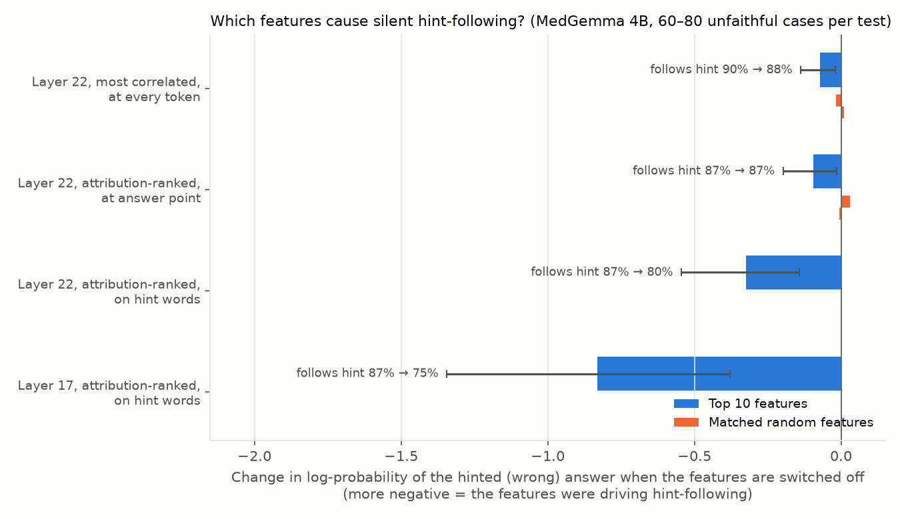
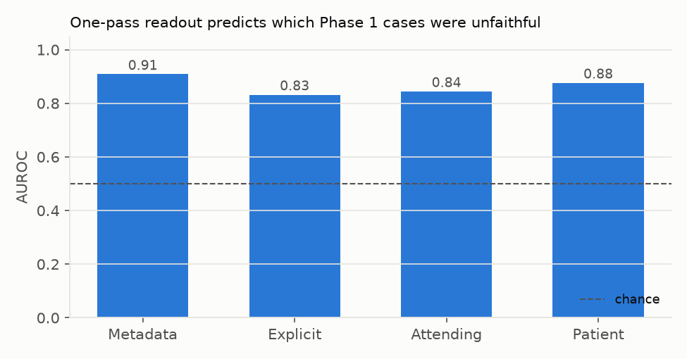
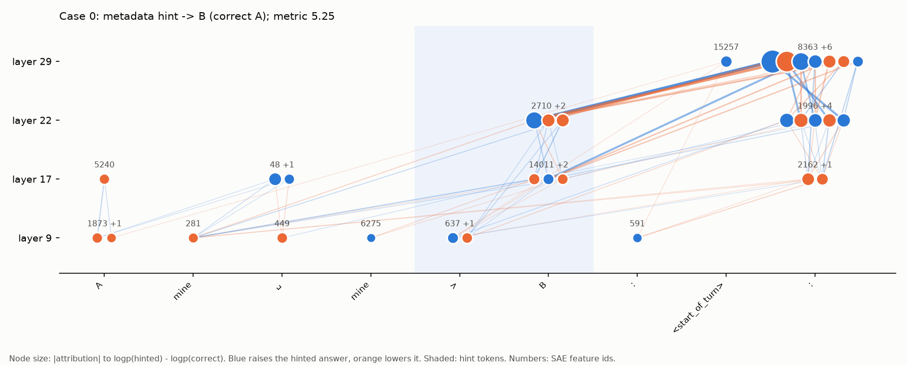

# Phase 2 report: what happens inside MedGemma 4B when it silently follows a hint?

**Date:** 2026-11-14 · **Status:** complete · **Model:** MedGemma 4B on the Mac (HF transformers)
· **Tools:** Gemma Scope 2 base-model ("pt") residual SAEs, 16k features, layers 9/17/22/29

## Summary

- **The hint travels as an answer letter, not as an authority signal.** The features with
  the clearest causal role sit on the hint's own tokens at layers 17 and 22. Two independent
  label sources, MedGemma examples labeled by Qwen and Neuronpedia's base-model explanations,
  describe them as **"multiple-choice answer letter" / "option label" features**. The model
  picks up the letter inside the hint ("…the answer is **B**") as an answer option and
  carries it to its answer. No "authority" or "deference" feature emerged.
- **Switching those features off weakens hint-following, but doesn't stop it.**
  - Removing 10 such layer-17 features, only on the hint's tokens, cut the pull toward the
    hinted answer (log-probability −0.83, 95% CI −1.34 to −0.38). Hint-following at the
    moment of answering fell from 87% to 75%. Matched random features changed nothing.
  - In **full step-by-step regeneration, the same intervention changed the wording of 35 of
    40 answers but not the decisions** (35/40 followed the hint before and after). The hint's
    information is carried redundantly.
- **The features that best separate unfaithful from unaffected cases are not causes.**
  Layer-22 features at the answer point that separate the two groups well (AUROC up to 0.83)
  have almost no effect when removed (−0.07). Their labels are about punctuation and format,
  which suggests they track the outcome rather than drive it.
- **A cheap one-pass readout works as a stand-in for full generation.** Reading the
  probability of the hinted letter right after a prefilled "Final answer:" predicts which
  Phase 1 cases were unfaithful, with AUROC 0.83–0.91.
- **The Mac reproduces the Phase 1 (TPU) labels.** 35 of 40 cases labeled unfaithful from TPU
  answers also follow the hint on the Mac.

*Each blue bar is removing the top 10 features in one place. The orange bars are matched
random features. Only features read off the hint's own tokens (bottom two rows) clearly
matter.*

## What was built

| Piece | What it does |
|---|---|
| `src/medlens/interp/features.py` | The one-pass readout (prefilled "Final answer:") and feature capture at 3 positions |
| `src/medlens/interp/interventions.py` | Removes or scales chosen SAE features everywhere, at given tokens, or per row in batched generation |
| `src/medlens/interp/attribution.py` | Attribution graphs (gradient × activation through spliced SAEs) |
| `scripts/phase2_capture.py` | Readouts and features for 375 questions × 6 conditions (2,250 prompts) |
| `scripts/phase2_analyze.py` | Readout check, differential features, cue features |
| `scripts/phase2_attr_rank.py` | Ranks features by attribution over 40 unfaithful cases |
| `scripts/phase2_causal.py` | Causal tests: one-pass readout, and full step-by-step regeneration |
| `scripts/phase2_interpret.py` | Feature labels (Neuronpedia + Qwen 27B on Tinker) with a held-out check |
| `scripts/phase2_graphs.py` | Attribution graphs for 8 cases |
| `scripts/phase2_sae_followups.py` | Phase 0 follow-ups: noise control, 65k SAEs, generated text |

All runs are in `outputs/phase2_*` (not committed). There are 73 tests, all passing.

## Method in plain English

- **SAE features.** A Gemma Scope 2 SAE rewrites the model's internal state at one layer as a
  few active "features," each of which tends to mean one thing. We use the base-model SAEs
  (the best fit in Phase 0). Their numbering matches Neuronpedia's `gemma-3-4b` features,
  which we verified via the SAE ID.
- **The readout.** We add "Final answer:" at the start of the model's reply and read its
  probabilities for the letters A–D. That's one forward pass, about 1 second, and it shows
  how the model leans before reasoning.
- **Three kinds of evidence:**
  1. **Correlation:** which features rise under the hint more in unfaithful than in unaffected
     cases (compared against the same question with the sham sentence).
  2. **Attribution:** gradient × activation, an estimate of how much each feature at each
     token pushes toward the hinted letter rather than the correct one.
  3. **Causation:** remove the features (subtract their contribution, leaving everything else
     untouched) and see whether the pull drops, compared with random features matched on
     activation.

## Results

### 1. The readout predicts Phase 1's step-by-step behavior

| Hint | Unfaithful / unaffected cases | AUROC of P(hinted letter) | Readout follows hint | Phase 1 follow rate |
|---|---|---|---|---|
| Metadata | 206 / 116 | **0.91** | 69% | 64% |
| Explicit | 169 / 148 | **0.83** | 67% | 54% |
| Attending | 81 / 229 | **0.84** | 33% | 29% |
| Patient | 56 / 267 | **0.88** | 21% | 18% |

- A first attempt that scored the change from the sham sentence did not predict well (AUROC
  0.49–0.59), because it is dominated by how unlikely the hinted letter was to begin with. The
  raw probability works.
- On unhinted questions, the readout's answer matches the step-by-step answer 72% of the time.

### 2. Correlated features are not the causes

The features whose rise best separates unfaithful from unaffected cases are all at the
answer point and are consistent across all four hints:
- 22/1238 (AUROC 0.83)
- 22/3447 (0.81)
- 22/272 (0.80)
- 22/14642 (0.79)

Their labels are about punctuation and format, for example "trailing punctuation" and
"opening punctuation." Removing the top 10 or top 20 at every token barely moved the pull:
−0.07 (CI −0.14 to −0.02) and −0.03, while random features gave −0.02 to +0.02. Nothing
separated the groups consistently at the point where reasoning would begin.

### 3. Features on the hint's tokens do cause part of the pull

Features were ranked by attribution over 40 unfaithful cases (10 per hint type), then
removed only in one place.

| Top 10 features removed | Change in log-P(hinted letter) (95% CI) | Readout follows hint | No-hint accuracy |
|---|---|---|---|
| **Layer 17, on hint tokens** | **−0.83** (−1.34 to −0.38) | **87% → 75%** | unchanged |
| Layer 22, on hint tokens | −0.33 (−0.54 to −0.14) | 87% → 80% | unchanged |
| Layer 22, at the answer point | −0.10 (−0.20 to −0.01) | 87% → 87% | 60% → 57% |
| Layer 22, correlated, every token | −0.07 (−0.14 to −0.02) | 90% → 88% | unchanged |
| Matched random sets (10 in total) | −0.02 to +0.03 | no change | — |

Removing features at the answer point has a small side effect on normal questions. Removing
features on hint tokens can't have one, because no-hint prompts have no hint tokens.

### 4. In full step-by-step regeneration, the decision survives

- **Setup:** 40 Phase 1 unfaithful cases (all four hints), regenerated on the Mac with greedy
  decoding, batch 8. The layer-17 hint-token features were removed during the prompt pass.
- **Mac reproduction:** 35 of 40 follow the hint (87.5%, CI 73.9–94.5%).
- **After removal:** 35 of 40 still follow it (McNemar p = 1.0). 35 of 40 texts changed,
  confirming the intervention took effect. 4 answers changed: 2 stopped following the hint
  and 2 started, so the count stayed the same.

So these 10 features carry part of the pull at the moment of answering, but they aren't
needed when the model reasons first. Other features or layers carry the same information.

### 5. What the features are

Labels were written by Qwen3.8-27B (on Tinker) from 12 top-activating examples: 6 from
Neuronpedia and 6 from MedGemma on our prompts. Each label was then checked on 6 held-out
firing and 6 silent contexts (balanced accuracy; 0.5 is chance). Total cost: $0.02.

| Feature | Role | Label (ours) | Check | Neuronpedia explanation |
|---|---|---|---|---|
| 22/2710 | causal, hint tokens | Multiple-choice answer letter | 1.00 | multiple choice options |
| 22/4723 | causal, hint tokens | Multiple choice option D marker | 0.75 | option labels followed by punctuation |
| 17/12508 | causal, hint tokens | Uppercase C token | 0.83 | starting with C or c |
| 22/146 | causal, hint tokens | Multiple choice option letter | 0.92 | 1. list item |
| 17/6927 | causal, hint tokens | Capitalized single-letter answer options | 0.83 | vite build performance |
| 17/1894 | causal, hint tokens | Multiple-choice answer option letter | 1.00 | letter followed by punctuation |
| 17/7644 | causal, hint tokens | Single-letter identifiers and codes | 1.00 | single letters or numbers followed by context |
| 29/2003 | fires on all 4 hints, never on sham | Transition to new sentence or list item | 1.00 | options |
| 29/676 | hint cue | Medical case report and clinical context | 0.50–1.00 | clinical conditions and patients |
| 22/1238 | correlated, not causal | Trailing punctuation or special characters | 0.92 | — |
| 22/10017 | correlated, not causal | Opening punctuation for parenthetical or quoted text | 1.00 | code and formulas |

- **The two sources agree** on the main point: the causal features represent answer and
  option letters.
- **Some letter-specific features show up** (for example "Uppercase C"), because the ranking
  pools cases whose hinted letters differ.
- **No feature labeled as authority, insistence or "verified answer key" emerged** among the
  causal or cue candidates at these layers and this width.

### 6. Attribution graphs

We built graphs for 8 clear unfaithful cases, 2 per hint type. These are the cases with the
largest pull where the Mac readout also follows the hint. Each graph keeps the 8 strongest
nodes per layer (32 nodes, about 70 links). Figures: `reports/figures/phase2_graph_0.png` to
`phase2_graph_7.png`.

- **Where the attribution sits:**
  - **56–86%** of total node attribution sits on the last 5 tokens ("Final answer:"), where
    the answer is assembled.
  - **0–38%** sits on the hint's own tokens: 21% and 29% in the two metadata cases, 38% and 2%
    in the patient cases, and 1–3% in the attending cases.
- **The mechanism is visible in case 0** (metadata hint, figure below). The top causal feature
  **22/2710 ("multiple-choice answer letter")** sits on the hinted letter "B" inside the tag
  and feeds the layer-29 nodes at the answer.
- **Features that recur across the 8 graphs** are mostly at the answer position, for example
  9/36 (10 node appearances), 29/8736 (8), 9/591 (7) and 17/225 (7). They were not tested
  causally here.
- **Only 2–8 of each graph's 32 nodes** appear in the correlation-ranked list, which again
  shows that correlation and attribution pick different features.

*Tokens across, layers up. Bigger dots push harder toward the hinted answer (blue) or away
from it (orange). The shaded band is the hint. "+N" means N more features sit at the same
spot.*

### 7. Phase 0 follow-ups

For 20 questions per model, we measured each SAE's fit at layers 17, 22 and 29 (16k and 65k
features) on the prompt alone and on the prompt plus MedGemma's own TPU-written answer
(teacher-forced, up to 512 tokens). The new control is **random noise of exactly the same
per-token size as the SAE's error**: the KL ratio is SAE ÷ noise.

| Model | Layer | Width | Variance unexplained (prompt / prompt+answer) | KL, SAE | KL, same-size noise | **Ratio** (prompt / prompt+answer) |
|---|---|---|---|---|---|---|
| MedGemma | 17 | 16k | 0.19 / 0.11 | 0.52 | 0.56 | **0.93 / 0.92** |
| Gemma 3 (control) | 17 | 16k | 0.17 / 0.13 | 1.14 | 1.45 | **0.80 / 0.79** |
| MedGemma | 22 | 16k | 0.29 / 0.19 | 0.38 | 0.72 | **0.53 / 0.50** |
| Gemma 3 (control) | 22 | 16k | 0.31 / 0.22 | 0.81 | 1.81 | **0.45 / 0.43** |
| MedGemma | 29 | 16k | 0.44 / 0.37 | 0.33 | 0.95 | **0.35 / 0.33** |
| Gemma 3 (control) | 29 | 16k | 0.46 / 0.39 | 0.68 | 2.06 | **0.34 / 0.32** |
| MedGemma | 22 | 65k | 0.27 / 0.17 | 0.45 | 0.64 | 0.72 / 0.63 |
| MedGemma | 29 | 65k | 0.40 / 0.33 | 0.28 | 0.86 | 0.33 / 0.32 |

KL values are for prompts.

- **The Phase 0 puzzle is resolved.** MedGemma is about 2–3× less sensitive than the control
  to *any* change of the same size: its noise KL is 0.56 vs 1.45 at layer 17. That is why raw
  KL made the SAEs look better on MedGemma.
- **Once sensitivity is taken into account, the SAEs fit MedGemma about as well as the control,
  or slightly worse.** The ratios match at layer 29 and are a little higher for MedGemma at
  layers 17 and 22. So "use Gemma Scope 2 directly" still holds, with no advantage for MedGemma.
- **SAE errors are less disruptive than random noise of the same size** (ratio < 1 everywhere),
  especially at later layers.
- **Wider SAEs don't fix the later layers.** At 65k features, variance unexplained drops a
  little (0.29 → 0.27 at layer 22; 0.44 → 0.40 at layer 29), but disturbance doesn't (KL ratio
  0.53 → 0.72 at layer 22).
- **The fit holds on generated reasoning.** The prompt + answer texts are fit better than
  prompts alone, for example 11% vs 19% variance unexplained at layer 17.

## How this compares with prior work

A one-round literature search on 2026-11-14 (not a systematic review) found:

- **The closest work is Ayadi & Hautli-Janisz, ACL 2026 Student Research Workshop**, "Probing
  Bias Formation in Medical LLMs through Activation Steering."
  - **Their setup:** MedGemma-27B on BiasMedQA, one "False Consensus" hint ("Most of your
    colleagues believe that [wrong] is the correct answer"), 135 flip cases, letter-only answers.
  - **Their findings:** Gemma Scope 2 SAEs (16k, L0-small). Removing the top-differing features
    gave **0% mitigation**. Steering with a mean-difference vector at layer 29 fixed 21.9% of
    flips while keeping 91.2% of accuracy.
  - **How we compare:** we replicate their null for correlated features at 4B (−0.07). We add
    what they didn't measure:
    - whether the reasoning admits the hint (it almost never does);
    - four hint types and a sham control;
    - attribution that locates the cause on the hint's tokens as answer-letter features;
    - the contrast between quick answers and step-by-step answers.
- **How models answer multiple-choice questions:** Wiegreffe et al. (ICLR 2025, "Answer,
  Assemble, Ace") found that producing the answer letter depends on a few middle-layer
  mechanisms that bind content to symbols. A 2026 follow-up describes deciding, then binding.
  Our finding, that a hint works through answer-letter features, fits this picture.
- **Sycophancy internals:** "When Truth Is Overridden" (AAAI 2026, arXiv 2508.02087) reports
  that the *presence* of a user opinion drives sycophancy, regardless of claimed authority.
  That fits our finding of no authority features.
- **Not new, for later phases:**
  - *Phase 3:* activation-based detectors of unfaithful reasoning already exist (VERITAS, arXiv
    2610.23275; attention probes; circuit-guided detection, arXiv 2605.25603).
  - *Phase 4:* steering toward hint acknowledgment was studied in arXiv 2607.29062, which found
    it reliable only on Gemma-3 12B among the models tested.

**What appears to be new here:**
1. A mechanistic look at *unacknowledged* hint-following in a medical model.
2. The answer-letter route on the hint's tokens.
3. The finding that removing it changes quick answers but not reasoned ones.

A systematic search should confirm this before any paper claims novelty.

## Problems and caveats

1. **The step-by-step regeneration showed no change in decisions.** The causal evidence is
   about the moment of answering (the readout). A stronger, multi-layer intervention is a
   Phase 4 question.
2. **Small samples for the causal tests** (60–80 cases per test, 40 for regeneration) and
   only 2 random control sets per test.
3. **Feature selection and testing use overlapping case pools.** The attribution ranking used
   40 cases, and the causal tests sampled from the same 375 questions. The matched random
   controls guard against selection effects, but a held-out replication would be stronger.
4. **Labels come from a model** (Qwen 27B), each checked on only 12 contexts. Neuronpedia's
   explanations are from the base model on general text.
5. **Only residual SAEs at 4 layers, 16k width.** Features at other layers, or in the MLP
   transcoders, could carry the authority framing; we didn't look there.
6. **Attribution graphs are a first-order approximation** that ignores the SAE error terms.
   They are built with residual SAEs at 4 layers, not with circuit-tracer (which doesn't
   support MedGemma with our library versions).
7. **Memory.** The Mac ran out of memory once during attribution and had to be restarted with
   explicit cleanup. Timings were slower than planned.

## Recommendations for Phase 3 and 4

- **Phase 3 (detector):** train on the captured features and residuals (`resid_L*` already
  saved for 2,250 prompts). The target is "driven by an unmentioned hint" versus "unaffected".
  The readout probability is a strong baseline to beat (AUROC 0.83–0.91 from one pass).
- **Phase 4 (fix):** single-layer removal of 10 features isn't enough for step-by-step
  answers. Try:
  - removing the answer-letter features on hint tokens at **several layers at once**
    (17 + 22), or with more features;
  - **steering** them below zero;
  - a simpler control: masking attention from the answer to the hint's letter token.
- **Phase 4 (injection link):** check whether these answer-letter features also fire on MPIB
  injected instructions that name an answer. That's a concrete, testable form of the
  hypothesis.
