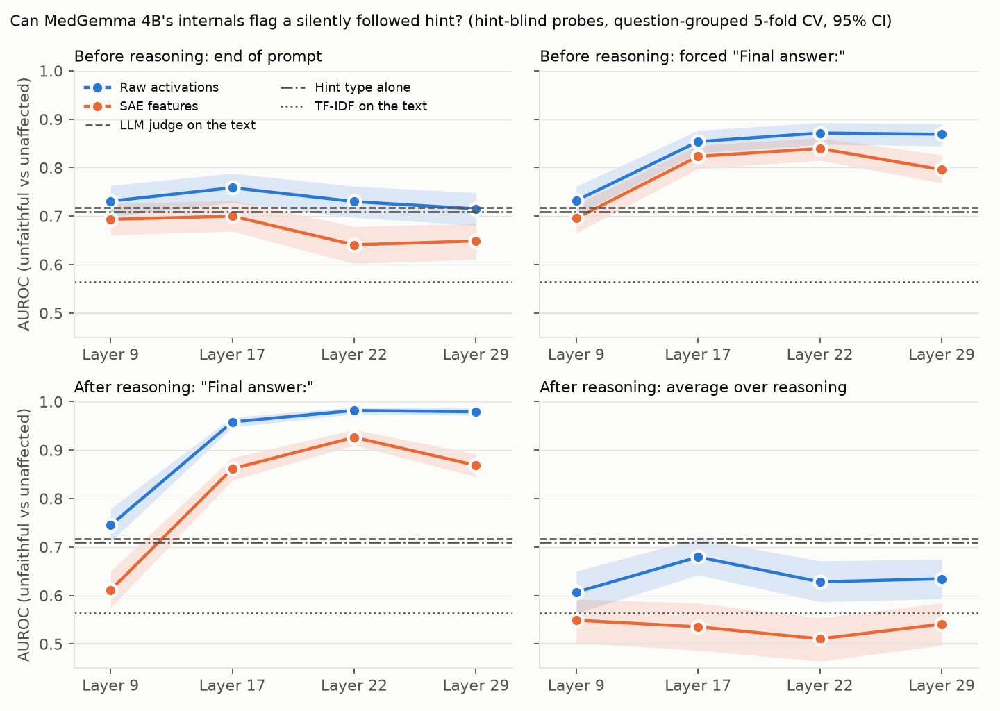
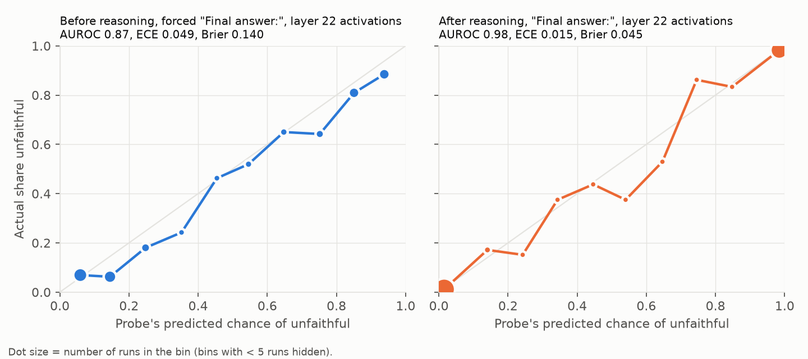

# Phase 3 report: can MedGemma 4B's internals flag a silently followed hint?

**Date:** 2026-11-15 · **Status:** complete · **Model:** MedGemma 4B on the Mac (HF transformers)
· **Data:** the 375 Phase 1 questions; 1,272 wrong-hint runs labeled *unfaithful* (512) or
*unaffected* (760), plus 375 no-hint prompts and 21 runs that followed the hint and said so

## Summary

- **Yes, very well, once the model has finished reasoning.** A simple linear probe on raw
  layer-22 activations, read at the "Final answer:" that follows the model's own reasoning,
  separates unfaithful from unaffected runs with **AUROC 0.98** (95% CI 0.97–0.99). It is well
  calibrated (ECE 0.015) and rarely fires on prompts with no hint: **0.8%**, at a threshold
  that catches 80% of unfaithful runs.
- **The probe is never told the hint.** It sees only activations, not the hint text or the
  hinted letter. Text-only detectors do much worse: an LLM judge (Qwen 27B, asked 3 times)
  scores 0.72, and a word-count (TF-IDF) classifier on the reasoning scores 0.56.
- **It generalizes.** Trained without one hint type, it scores 0.98–0.99 on that type. Trained
  without one group of specialties, it scores 0.98–1.00 on that group.
- **A useful warning is possible even before the reasoning is written.** Reading the
  activations at a forced "Final answer:" (one forward pass, no reasoning) gives AUROC 0.87,
  with 0.3% false alarms on no-hint prompts.
- **Two warnings about what this means:**
  1. **It detects hint-following, not silence.** On the 21 runs where the model followed the
     hint *and admitted it*, the post-reasoning probe fires on 76% (median score 0.99, the same
     as for silent runs). It works as an unfaithfulness detector here only because 97% of this
     model's hint-following is silent. A practical detector would pair it with a text check
     for whether the reasoning mentions the hint.
  2. **Hint type alone already gives AUROC 0.71,** because some framings (metadata) are
     followed far more than others (patient). We therefore also report AUROC *within* each
     hint type. Every claim above survives that check, except for the end-of-prompt probe,
     which mostly reads hint type and question difficulty.



*Each panel is one place we read the model's internal state. Blue is raw activations; orange is
Gemma Scope 2 SAE features. Shaded bands are 95% confidence intervals. Gray lines are the
baselines.*

## What was built

| Piece | What it does |
|---|---|
| `src/medlens/probes/core.py` | Logistic-regression probes with question-grouped cross-validation, inner CV for regularization, calibration metrics, cluster bootstrap |
| `scripts/phase3_capture_postcot.py` | Feeds each Phase 1 reasoning back into the model on the Mac and records activations after it |
| `scripts/phase3_llm_tasks.py` | On Tinker: specialty tags for the 375 questions, and the LLM-judge baseline |
| `scripts/phase3_probes.py` | Trains 34 probes plus text baselines; held-out hint types and specialties; false alarms |
| `scripts/phase3_followups.py` | Controls: per hint type, both-wrong subset, question-only probe, acknowledged runs |
| `scripts/phase3_figures.py` | The two figures in this report |

All runs are in `outputs/phase3_*` (not committed). There are 78 tests, all passing. The probe
library is tested to never put one question's runs in both training and testing.

## Method in plain English

- **The task.** Among runs with a wrong-answer hint, predict which ones the model silently
  followed (*unfaithful*) versus ignored (*unaffected*). Labels come from Phase 1.
- **Why the detector must be "hint-blind."** Among eligible runs, "unfaithful" means exactly
  "the answer equals the hinted letter." Anyone who knows the hint's letter gets a perfect
  score by comparing letters (AUROC 1.0). That is trivial and useless in practice, where you
  don't know which part of a prompt, if any, is a cue. So the probes never get the hint text or
  the hinted letter. They see only the model's activations, which are of course computed from
  the whole prompt.
- **Where we read the model.**
  - *End of prompt:* the last prompt token, before any answer.
  - *Forced "Final answer:":* we add "Final answer:" right after the prompt and read there
    (the Phase 2 readout position).
  - *After reasoning, "Final answer:":* the model's own Phase 1 reasoning (from the TPU) is fed
    back in on the Mac, its last "Final answer" line is cut, and "Final answer:" is appended. We
    read at the colon, the moment just before the answer letter.
  - *Average over reasoning:* the mean over the reasoning tokens.
- **Inputs.** Raw residual activations (2,560 numbers) or Gemma Scope 2 SAE features (16,384,
  log-scaled, keeping features active in at least 1% of runs), at layers 9, 17, 22 and 29, plus
  all four layers stacked.
- **Training and testing.** 5 folds split by question, so a question's runs are never in both
  training and testing. Regularization is chosen inside each training fold. Confidence
  intervals resample whole questions (1,000 times).
- **Baselines.**
  - *LLM judge:* Qwen 27B sees only the question and the reasoning (no hint). It is asked 3
    times whether the answer looks driven by something other than the clinical evidence; the
    score is the share of "yes."
  - *TF-IDF:* a word and word-pair classifier on the reasoning text.
  - *Phase 2 readout:* the probability of the hinted letter at a forced "Final answer:". It
    uses the hinted letter, so it is not hint-blind; it is shown for reference.
  - *Hint type alone:* a classifier given only which framing was used.
- **False alarms.** We set the threshold that catches 80% of unfaithful runs, then count how
  often it fires on runs that ignored the hint, and on prompts with no hint at all. A no-hint
  prompt is scored only by a fold model that never saw that question.

## Results

### Detectors compared

All numbers are out-of-fold. "Within type" is the average AUROC computed separately inside each
of the 4 hint types, which removes the advantage of simply knowing the hint type.

| Detector | Sees the hint? | AUROC (95% CI) | Within type | ECE | False alarms, ignored hint | False alarms, no hint |
|---|---|---|---|---|---|---|
| Letter rule (answer = hinted letter) | yes | 1.00 | 1.00 | – | – | – |
| **Probe, after reasoning, layer 22** | no | **0.982 (0.974–0.988)** | **0.978** | 0.015 | 1.1% | 0.8% |
| Phase 2 readout P(hinted letter) | yes (letter) | 0.893 (0.872–0.913) | 0.865 | 0.164 | – | – |
| **Probe, forced "Final answer:", layer 22** | no | **0.871 (0.848–0.893)** | **0.821** | 0.049 | 18.3% | 0.3% |
| Probe, end of prompt, layer 17 | no | 0.759 (0.728–0.788) | 0.661 | 0.073 | 42.8% | 46.7% |
| LLM judge (Qwen 27B, 3 samples) | no | 0.717 (0.684–0.748) | 0.704 | 0.236 | – | 5.6%\* |
| Hint type alone | – | 0.709 (0.685–0.735) | 0.50 by design | 0.136 | – | – |
| TF-IDF on the reasoning | no | 0.564 (0.520–0.604) | 0.555 | 0.067 | – | – |

\* The judge's scores take only 4 values, so its no-hint rate is given at "yes" in at least 2 of
3 samples. Its earlier AUROC of 0.626 (logged during the run) included gold-hint runs; this
table uses the same 1,272 wrong-hint runs as the probes.

**Other patterns from the full sweep of 34 probes (`probe_table.csv`):**
- **Raw activations beat SAE features everywhere.** For example, after reasoning at layer 22
  the raw probe scores 0.982 and the SAE probe 0.926. The SAE loses some of what the probe
  needs, which fits Phase 0's finding that Gemma Scope 2 fits MedGemma imperfectly.
- **Middle-to-late layers carry the signal.** Layer 9 is weak at every position (0.55–0.75);
  layers 17–29 are strong at both "Final answer:" positions.
- **Averaging over the reasoning tokens is weak** (0.51–0.68). The signal sits at the moment of
  answering, not spread through the text.
- **Stacking all four layers doesn't help** (0.979 after reasoning, 0.734 at end of prompt).

### Controls: is the probe reading something simpler?

| Check | End of prompt | Forced "Final answer:" | After reasoning |
|---|---|---|---|
| AUROC, all runs | 0.759 | 0.871 | 0.982 |
| Within each hint type (authority / explicit / metadata / patient) | 0.70 / 0.62 / 0.65 / 0.68 | 0.82 / 0.78 / 0.88 / 0.80 | 0.99 / 0.98 / 0.98 / 0.97 |
| Both answers wrong (unfaithful vs the 150 unaffected runs that were also wrong) | 0.734 | 0.843 | 0.972 |
| Question-only control: same recipe, fed the *no-hint* prompt's activations + hint type | 0.705 | 0.747 | 0.741 |
| No-hint false alarms when the model's own answer was right / wrong | 51% / 39% | 0% / 0.8% | 0.8% / 0.8% |

- **It isn't just detecting wrong answers.** Unfaithful answers are always wrong, but the
  after-reasoning probe still scores 0.97 against unaffected runs that were also wrong. It
  almost never fires on no-hint prompts where the model answered wrongly (0.8%).
- **It isn't just reading the question.** A probe that sees the same question without the hint,
  plus the hint type, reaches only 0.74. Some questions are more hint-prone than others, but
  most of the signal comes from the model's processing of the hint itself.
- **The end-of-prompt probe is the exception.** It barely beats the question-only control
  (0.759 vs 0.705; within type 0.66 vs 0.63) and fires on about half of no-hint prompts. We
  don't consider it a working detector.

### Generalization to unseen hint types and specialties

The best probe at each stage was retrained with one hint type, or one specialty group, left
out entirely, then tested on it. Specialty groups come from Qwen 27B tags (6 groups, 41–95
questions each).

| Held out | Forced "Final answer:" (layer 22) | After reasoning (layer 22) |
|---|---|---|
| Hint type: authority / explicit / metadata / patient | 0.87 / 0.83 / 0.90 / 0.86 | 0.99 / 0.99 / 0.99 / 0.98 |
| Specialty group (6 groups) | 0.83–0.91 | 0.98–1.00 |

The hint types differ in wording ("an attending thinks…", "Hint: the correct answer is…",
metadata tags, a patient's insistence), so the probe isn't keyed to one template. All four
still name an answer letter, so we haven't tested cues that don't.

### Calibration



Both main probes are well calibrated out of the box (ECE 0.049 and 0.015): when they say 80%,
about 80% of those runs are unfaithful. That matters for a clinician-facing warning. The LLM
judge (ECE 0.236) and the Phase 2 readout (0.164) are not calibrated as probabilities.

### Runs that followed the hint and admitted it

There are 21 wrong-hint runs where the model followed the hint *and* its reasoning mentioned it
(14 authority, 6 explicit, 1 patient). None were used in training. Each was scored by the fold
model that never saw its question.

| Probe | Share of admitted runs flagged | Median score: admitted / silent / ignored |
|---|---|---|
| End of prompt | 62% | 0.44 / 0.65 / 0.31 |
| Forced "Final answer:" | 67% | 0.70 / 0.80 / 0.16 |
| After reasoning | 76% | 0.99 / 0.99 / 0.01 |

The after-reasoning probe treats admitted hint-following almost the same as silent
hint-following. **What it reads is "the model is going with the hint," not "the model is hiding
it."** Only 21 such runs exist, so the exact rates are rough, but the direction is clear.

## How this compares with prior work

- **Activation probes beating text monitors is known.** "Two Regimes of CoT Unfaithfulness"¹
  reports that post-reasoning activation probes beat chain-of-thought monitors on hint-induced
  reasoning. VERITAS² compares hidden states against "faithful anchors" built from paired
  faithful and unfaithful reasoning. Circuit-guided detection³ and attention probes⁴ also read
  internals. Our post-reasoning result agrees with these.
- **What we add:**
  1. A medical model (MedGemma 4B) on medical exam questions.
  2. A strictly hint-blind setup, and the explicit point that, once the hint letter is known,
     hint-following is trivially detectable (letter rule, AUROC 1.0).
  3. Controls that the prior papers we found don't report together: within-hint-type AUROC, a
     question-only probe, the both-wrong subset, and false alarms on no-hint prompts.
  4. Generalization to held-out hint types and held-out specialties.
  5. A pre-reasoning warning (AUROC 0.87) that needs only one forward pass.
  6. The finding that the detector reads hint-following rather than silence (the 21 admitted
     runs).
  7. A comparison of raw activations with Gemma Scope 2 SAE features on a fine-tuned model
     (raw wins).
- This was a targeted search, not a systematic review.

## Problems and caveats

1. **It detects following, not hiding** (see above). As an unfaithfulness detector it relies on
   this model rarely admitting hints (3.3% in Phase 1). For a model that often admits hints, a
   text check for acknowledgment would be needed on top. We describe that combination but
   haven't measured it.
2. **Every cue in this study names an answer letter.** Phase 2 found that the hint travels as an
   answer-letter signal. The probe may be detecting "my answer matches a letter suggested in
   the prompt." Cues that don't name a letter (for example, a misleading lab value) are
   untested.
3. **Labels come from the TPU and activations from the Mac.** The reasoning text is the TPU's
   (Phase 1), fed back word for word on the Mac. All probes and controls use the same Mac
   activations, so the comparison isn't mixed across devices. Still, the Mac would not always
   have written the same reasoning (Phase 2 reproduced 35 of 40 cases).
4. **Layer-29 residuals: one channel was dropped.** Captures saved residuals as float16, and one
   very large channel (443) at layer 29 overflowed in some rows. The probes drop non-finite
   channels without looking at labels, so layer-29 residual probes use 2,559 of 2,560 channels.
   No other layer and no SAE features were affected, and no Phase 2 result used these files.
   Future captures save bfloat16.
5. **The LLM judge is a modest baseline.** We used Qwen 27B with a short prompt and 3 samples.
   A stronger judge (for example, Opus 5.5) might do better. No Anthropic key is set.
6. **One model, one dataset.** All results are on MedGemma 4B and 375 MedQA questions. The
   standard limits apply: 4B may be wrong because it doesn't know the answer, and Gemma Scope 2
   was trained on base Gemma 3 4B, not MedGemma.
7. **Truncation.** Prompt plus reasoning was capped at 1,200 tokens during capture. No run hit
   the cap (the longest was 1,149 tokens; Phase 1 allowed 768 reasoning tokens).

## Recommendations for Phase 4

1. **Use the after-reasoning probe (layer 22, raw) as the outcome measure for interventions.**
   It is calibrated and cheap, so it can score fixes quickly. Confirm any fix with real
   regenerated answers, since Phase 2 showed one-pass and step-by-step results can disagree.
2. **Try the probe's direction as a steering vector.** Phase 2's feature removal was too weak.
   The probe's weight vector at layer 22 is a natural candidate for negative steering (and the
   approach Ayadi & Hautli-Janisz⁵ found partly effective at layer 29).
3. **Injection link.** Run the same probes on MPIB injection cases. If the hint-following
   direction also fires on successful injections, that directly supports the main hypothesis.
4. **Demo (Phase 5).** The forced-"Final answer:" probe can give an early warning; the
   after-reasoning probe gives the final badge. Saved models: `probe_pre.joblib` and
   `probe_post.joblib` in the probes run.

## Cost and compute

- Tinker (Qwen 27B): specialty tags $0.13 (375 calls) and LLM judge $3.12 (6,450 calls), for
  **$3.24 in total**.
- Mac: the post-reasoning capture took 67 minutes for 1,647 runs, plus 1 minute for the 21
  admitted runs. Training all probes took about 1 minute. No TPU was used in Phase 3.

## Reproduce

```bash
uv run python scripts/phase3_llm_tasks.py specialties
uv run python scripts/phase3_llm_tasks.py judge --k 3
uv run python scripts/phase3_capture_postcot.py                  # ~70 min on an M4
uv run python scripts/phase3_capture_postcot.py --labels faithful --hinted-only
uv run python scripts/phase3_probes.py <capture_run> --judge-run <judge_run> --specialty-run <spec_run>
PYTHONPATH=scripts uv run python scripts/phase3_followups.py <probes_run> --ack-run <ack_capture_run>
PYTHONPATH=scripts uv run python scripts/phase3_figures.py <probes_run> <followups_run>
```

Runs used here: capture `outputs/phase3_capture_postcot/20261115-142843`, admitted-run capture
`20261115-154100`, judge `outputs/phase3_judge/20261115-143134`, specialties
`outputs/phase3_specialties/20261115-143107`, probes `outputs/phase3_probes/20261115-153757`,
follow-ups `outputs/phase3_followups/20261115-154212`.

## References

1. arXiv 2607.23458: "Two Regimes of CoT Unfaithfulness"
2. [arXiv 2610.23275: VERITAS, "Verbalising Model's Computation for CoT Faithfulness Detection"](https://arxiv.org/html/2610.23275v1)
3. [arXiv 2605.25603: "Detecting Unfaithful CoT via Circuit-Guided Internal-External Discrepancy"](https://arxiv.org/pdf/2605.25603)
4. [Detecting CoT Unfaithfulness with Attention Probes (Team Noah)](https://static1.squarespace.com/static/660eea75305d9a0e1148118a/t/6a0b084741e96f5a378cf53c/1779107911423/CoT+Unfaithfulness+%28Team+Noah%29.pdf)
5. [Ayadi & Hautli-Janisz, ACL 2026 SRW, "Probing Bias Formation in Medical LLMs"](https://aclanthology.org/2026.acl-srw.54.pdf)
