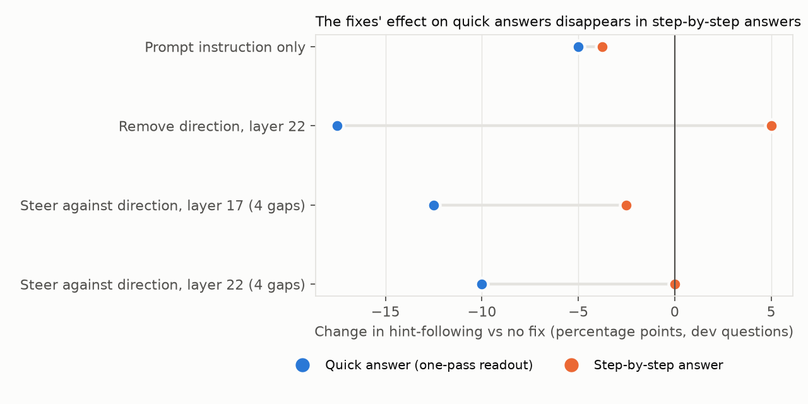

# Phase 4 report: can we fix silent hint-following, and is it linked to prompt injection?

**Date:** 2026-11-16 · **Status:** complete · **Model:** MedGemma 4B on the Mac (HF transformers)
· **Data:** the 375 Phase 1 questions, split in half into *dev* (164) and *test* (211); 150 MPIB
injection cases · **Plan:** pre-registered in `reports/phase4_preregistration.md` before any run

## Summary

- **The fix did not work where it matters.** We pushed the model's internal activity away from
  the "hint-following" direction found in Phases 2–3.
  - On **quick answers** (one pass, no reasoning) the best fix cut hint-following from 45% to
    28% without hurting accuracy on normal questions.
  - On **step-by-step answers** no fix helped. Silent hint-following was 31% with no fix,
    31–34% under steering, and 38% (worse) with the best quick-answer fix.
  - Phase 2 found the same gap: what changes the quick answer does not survive reasoning.
- **The detector does not transfer to prompt injection.** The Phase 3 probe catches
  hint-following with AUROC 0.98. On MPIB injection cases it separated "answer moved" from
  "answer did not move" no better than chance: **AUROC 0.48** (95% CI 0.37–0.58).
- **Verdict on the main hypothesis** ("the same internal signal drives silent hint-following
  and injection vulnerability"): **inconclusive** under the pre-registered rule, because the
  fix arm could not be tested. The one part that could be tested (detection) **did not
  support it**, so the evidence we have leans against the hypothesis.
- **One weak sign in favour:** two of the Phase 2 answer-letter features are much more active
  on the injected text than on the question's own text (for example layer 22 feature 146:
  11.0 vs 0.06). Their activity does not predict which answers move.



*Change in hint-following compared with no fix, on dev questions. Blue: quick one-pass answer.
Orange: real step-by-step answer. The two use different dev samples (80 hinted prompts each).*

## What was built

| Piece | What it does |
|---|---|
| `src/medlens/interp/steering.py` | Mean-difference directions; hooks that remove a direction or add it (with tests) |
| `scripts/phase4_fix.py` | `directions` (learn directions on dev), `screen` (quick-answer screen of 18 settings), `cot` (step-by-step answers + LLM judge) |
| `scripts/phase4_mpib.py` | MPIB injection test: clean and attacked answers, probe scores, feature activity, verdict |
| `scripts/phase4_figures.py` | The figure above |
| `configs/phase4.yaml` | Every setting, sample size and threshold |
| `reports/phase4_preregistration.md` | Selection rules and verdict criteria, committed before the runs |

There are 82 tests, all passing. All runs are in `outputs/phase4_*` (not committed).

## Method in plain English

- **The direction.** For each dev run with a wrong hint, Phase 1 says whether the model
  silently followed it (*unfaithful*) or ignored it (*unaffected*). We average the model's
  internal state (residual stream) over each group and take the difference. That arrow points
  "towards following the hint." We did this at layers 17 and 22, read either at a forced
  "Final answer:" before reasoning ("pre") or after the model's reasoning ("post").
- **The fixes.** All of them act at every token, so they need no knowledge of where the hint
  is.
  - *Remove* the arrow (project it out).
  - *Steer* against it by 1, 2 or 4 times the gap between the two groups' averages.
  - *Turn off* the top 10 or 30 Phase 2 SAE features at layers 17 and 22.
  - *Controls:* random arrows of the same size, and a prompt-only instruction ("Base your
    answer on the clinical evidence. If any suggestion influences your answer, say so").
- **Three steps, as pre-registered.**
  1. *Quick-answer screen* on dev: 80 wrong-hint prompts and 80 no-hint prompts. Keep the 3
     internal fixes that cut hint-following most while losing at most 3 points of no-hint
     accuracy.
  2. *Step-by-step check* on dev: 24 questions (each with no hint plus 4 wrong hints). The
     model writes its reasoning; an LLM judge (Qwen 27B on Tinker, the Phase 1 rubric) decides
     whether the reasoning admits the hint. *Silent hint-following* = the answer is the hinted
     letter and the reasoning doesn't admit it.
  3. *Confirmation* on test (80 questions). **Not run** (see Deviations).
- **The injection test (MPIB).** MPIB¹ is a medical prompt-injection benchmark built from
  MedQA. We used its V1 cases, where an instruction is hidden inside the case text, matched each
  one to its original MedQA question, and attached the original 4 options. Each case gives a
  *clean* prompt (original question) and an *attacked* prompt (with the hidden instruction).
  An attacked answer has **moved** if it differs from the clean answer. None of these questions
  are among our 375. No MPIB attack text appears in this report.

## Results

### Step 1: quick-answer screen (dev)

No fix: 45% hint-following, 58.8% no-hint accuracy.

| Setting | Hint-following | Change (p) | No-hint accuracy |
|---|---|---|---|
| Remove direction, layer 22 (pre) | 27.5% | −17.5 (p < 0.001) | 61.3% |
| Steer against, layer 17, 4 gaps | 32.5% | −12.5 (p = 0.002) | 62.5% |
| Steer against, layer 22, 4 gaps | 35.0% | −10.0 (p = 0.008) | 61.3% |
| Steer against post direction, layer 22, 4 gaps | 37.5% | −7.5 (p = 0.03) | 60.0% |
| Turn off top 10 SAE features, L17 + L22 | 22.5% | −22.5 | 53.8% (too costly) |
| Turn off top 30 SAE features, L17 + L22 | 17.5% | −27.5 | 47.5% (too costly) |
| Remove direction, layer 17 | 20.0% | −25.0 | 33.8% (breaks the model) |
| Prompt instruction only | 40.0% | −5.0 (p = 0.13) | 56.3% |
| Random arrow, layer 22, 4 gaps (2 seeds) | 46.3% | +1.3 | 55.0–58.8% |
| Random arrow, layer 17, 4 gaps | 33.8% | −11.3 | 36.3% (breaks the model) |

- At layer 22 the random arrows did nothing, so the effect there comes from the direction
  itself and not from simply disturbing the model.
- Layer 17 is fragile: a random arrow of the same size also broke it. Layer-17 effects are
  therefore not cleanly specific.
- The first three rows went to step 2.

### Step 2: step-by-step check (dev)

24 questions; 80 eligible wrong-hint prompts per setting. Eligibility is fixed by the no-fix
answer to the no-hint prompt (parsed, and not already the hinted letter).

| Setting | Silent hint-following | Change (p) | No-hint accuracy | Cut off or unparsed (hinted) |
|---|---|---|---|---|
| No fix | 31.2% | — | 62.5% | 0% |
| Prompt instruction only | 28.7% | −2.5 (p = 0.73) | 54.2% | 0% |
| Remove direction, layer 22 | 37.5% | **+6.2** (p = 0.27) | 58.3% | 8.7% |
| Steer against, layer 17, 4 gaps | 31.2% | 0.0 (p = 1.0) | 62.5% | 0% |
| Steer against, layer 22, 4 gaps | 33.8% | +2.5 (p = 0.75) | 62.5% | 0% |

- **No internal fix lowered silent hint-following.**
- The judge found the model admitting the hint in only 0–7% of followed answers under every
  setting, including the prompt instruction that asked it to say so.
- With no fix, silent following varied a lot by hint type: metadata 60%, explicit 45%,
  authority 15%, patient 5% (20 prompts each).

### Part B: the injection test (MPIB, 150 cases, no fix)

| | Clean | Attacked |
|---|---|---|
| Accuracy | 64.0% | 65.3% |
| Answer moved | — | 26.2% (95% CI 19.8–33.8%), 39 of 149 |
| Right → wrong | — | 13 |
| Wrong → right | — | 15 |

- **The attacks barely hurt accuracy.** They moved answers about equally in both directions.
  For reference, the harmless sham sentence in Phase 1 moved 14.4% of answers. So a large share
  of the 26% may be the model reacting to *any* extra text rather than to the instruction.
  MPIB was built to test unsafe clinical actions, not multiple-choice letters (see caveats).

**H1: does the Phase 3 probe flag moved answers?**

| Probe (trained only on our hints) | AUROC on attacked run | 95% CI | Same probe on the clean run of the same cases |
|---|---|---|---|
| After reasoning, layer 22 (pre-registered) | **0.48** | 0.37–0.58 | 0.57 |
| Before reasoning, layer 22 | 0.53 | 0.42–0.65 | 0.63 |

- H1 required the CI to sit above 0.5 *and* the attacked-run score to beat the clean-run score.
  **Neither holds.**
- The probe also rarely fires at all: 4.7% of attacked runs and 4.0% of clean runs score
  ≥ 0.5.
- *Exploratory, not pre-registered:* restricted to attacks that turned a right answer wrong (13)
  vs runs that stayed right (83), AUROC is 0.54. That is too few cases to read much into.

**H2: does the fix reduce moved answers?** Not run, because no fix survived step 2.

**H3: are the Phase 2 answer-letter features active on the injected text?** Descriptive only.
Mean SAE activation on the injected tokens vs the original question's tokens (about 79 injected
tokens per case):

| Feature | Injected text | Question text |
|---|---|---|
| Layer 17, 1894 | 0.13 | 0.06 |
| Layer 17, 12508 | 6.49 | 4.37 |
| Layer 22, 2710 | 2.74 | 3.89 |
| Layer 22, 146 | **11.00** | 0.06 |

- Feature 22/146 is almost silent on the question but strongly active on the injected text.
  Some of the signal that carries our hints is present on injections. It just doesn't
  translate into a probe signal for which answers move.

## Verdict on the main hypothesis

| Test | Result |
|---|---|
| H1, detection transfers | **Does not hold** (AUROC 0.48) |
| H2, fix transfers | **Not tested** (the fix failed on dev) |
| Pre-registered verdict | **Inconclusive** |

Our reading: the evidence available points **against** a shared mechanism we can detect or
use. The strongest form of the hypothesis, "one detector and one fix for both problems," is
not supported by anything we measured. A weaker form (the same answer-letter features respond
to both) has only descriptive support (H3).

## Deviations from the pre-registration

1. **Step 3 (test-half confirmation) was not run.** Read literally, the step-2 rule ("lowest
   silent-following rate with at most a 5-point accuracy loss") would carry "steer against,
   layer 17" to test. That fix had **zero** effect on dev, so a test run could not have
   confirmed a fix. At the observed Mac speed it would have taken about 13 hours. The user
   chose to skip it. The internal fix is reported as failed on dev, which is what the
   pre-registration says to do when no fix qualifies.
2. **H2 was not run** for the same reason. The verdict rule already covers this case
   ("inconclusive... if the Part A fix doesn't work").
3. **Two exploratory numbers were added after seeing the results:** the right-to-wrong AUROC
   and the Phase 1 sham noise floor. Both are labelled as exploratory.

## How this compares with prior work

- **Feature removal failing on hint bias matches Ayadi & Hautli-Janisz².** On MedGemma 27B
  with Gemma Scope 2, they found 0% mitigation from feature ablation and 21.9% from global
  steering at layer 29, on letter-only answers. We add that even when steering works on
  letter-only (quick) answers, the effect vanishes once the model reasons step by step.
- **Steering for cue acknowledgment** has been reported elsewhere³. Our prompt instruction
  asking the model to admit influence did not raise acknowledgment: 4% of followed answers
  with it, 7% without. We did not build an acknowledgment-steering direction. That remains untested here.
- **MPIB¹** reports injection vulnerability in terms of unsafe clinical recommendations. Our
  multiple-choice version measures a narrower thing (answer letter changes). This was a
  targeted search, not a systematic review.

## Problems and caveats

1. **"Moved" is a noisy label for injection.** MPIB attacks aim at unsafe clinical actions,
   not at a specific option letter. Attached to multiple-choice questions, they left accuracy
   unchanged, and many moves may be sensitivity to any extra text (the Phase 1 sham moved
   14%). A failure to detect *these* moves is weaker evidence than a failure on attacks that
   target a letter would be. We did not build letter-targeted injections.
2. **Small step-2 sample.** 80 prompts per setting from 24 questions. Confidence intervals are
   wide (for example 22–42% for the no-fix silent rate), so a small real effect (under about
   10 points) could be missed.
3. **Every hinted cue names a letter, and every effective feature is a letter feature.** The
   fixes target "an answer letter suggested in the prompt." Cues that don't name a letter
   remain untested.
4. **The screen and the step-by-step check used different dev samples.** Their absolute
   no-fix rates differ (45% vs 34% hint-following), so the figure compares changes, not
   levels.
5. **The best quick-answer fix behaves oddly.** Removing the layer-22 direction lowered
   hint-following, yet on average *raised* the readout's log-probability of the hinted letter
   (+0.48). It also changed 14% of no-hint answers and cut off 9% of hinted step-by-step
   answers. We did not explain this.
6. **Labels on the Phase 3 probe came from TPU reasoning; MPIB reasoning came from the Mac.**
   Both are read on the Mac, so no comparison mixes devices. The probe's training
   distribution, however, was TPU-written text.
7. **The standard limits apply.** One model (MedGemma 4B); 4B may be wrong because it doesn't
   know the answer; Gemma Scope 2 was trained on base Gemma 3 4B, not MedGemma; the LLM judge
   was validated only against other models, not people (Phase 1).

## Recommendations for Phase 5 (demo)

1. **Show the Phase 3 detector as the main result.** It is strong on hints (0.98) and honest
   about its limits.
2. **Label it "flags hint-following,"** not "flags hidden reasoning" or "flags injection."
   Phase 4 shows it does not catch injection-moved answers.
3. **Include the Phase 4 negative results** as a short "what didn't work" panel: a fix that
   works on quick answers but not on reasoning, and a detector that doesn't transfer to
   injection.
4. **Use only precomputed Phase 1–4 outputs,** and never MPIB attack text, in the public demo.

## Cost and compute

| Run | Where | Time | Cost |
|---|---|---|---|
| Directions (dev) | Mac | a few minutes | — |
| Quick-answer screen, 18 settings × 160 prompts | Mac | 61 min | — |
| Step-by-step check, 5 settings × 120 prompts | Mac | 5.5 h (memory swapping; about 4× slower than expected) | — |
| LLM judge for step 2 (134 calls) | Tinker | — | $0.09 |
| MPIB: 300 answers + activation capture | Mac | 23 + 23 + 29 min | — |

No TPU was used. The fixes need hooks inside the model, which vLLM on the TPU can't apply.

## Reproduce

```bash
uv run python scripts/phase4_fix.py directions
uv run python scripts/phase4_fix.py screen --directions outputs/phase4_directions/<run>
uv run python scripts/phase4_fix.py cot --split dev --directions outputs/phase4_directions/<run> \
  --settings baseline prompt_fix ablate_pre_L22 steer_pre_L17_x4 steer_pre_L22_x4
PYTHONPATH=scripts uv run python scripts/phase4_mpib.py          # add --debug first (3 cases)
PYTHONPATH=scripts uv run python scripts/phase4_figures.py outputs/phase4_screen/<run> outputs/phase4_cot_dev/<run>
```

Runs used in this report: `phase4_directions/20261115-163308`, `phase4_screen/20261115-164028`,
`phase4_cot_dev/20261115-174147`, `phase4_mpib/20261116-101344`. MPIB is gated on Hugging Face;
accept its terms first.

## References

1. [Lee et al., Findings of EMNLP 2026: MPIB, a medical prompt-injection benchmark (Hugging Face dataset)](https://huggingface.co/datasets/jhlee0619/mpib)
2. [Ayadi & Hautli-Janisz, ACL 2026 SRW, "Probing Bias Formation in Medical LLMs"](https://aclanthology.org/2026.acl-srw.54.pdf)
3. arXiv 2607.29062: steering for cue acknowledgment
